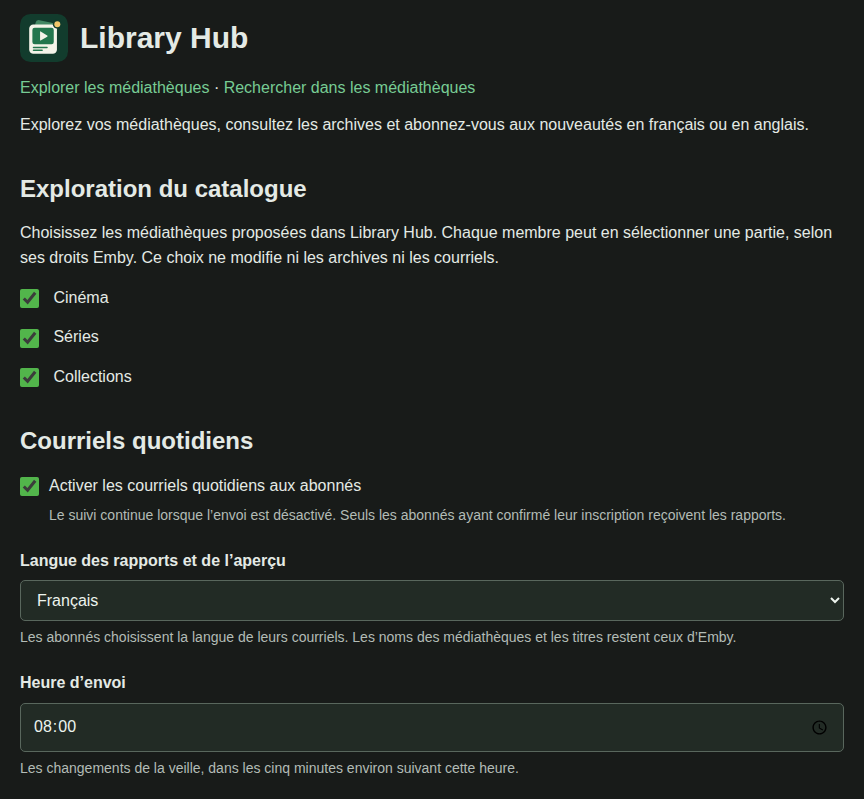
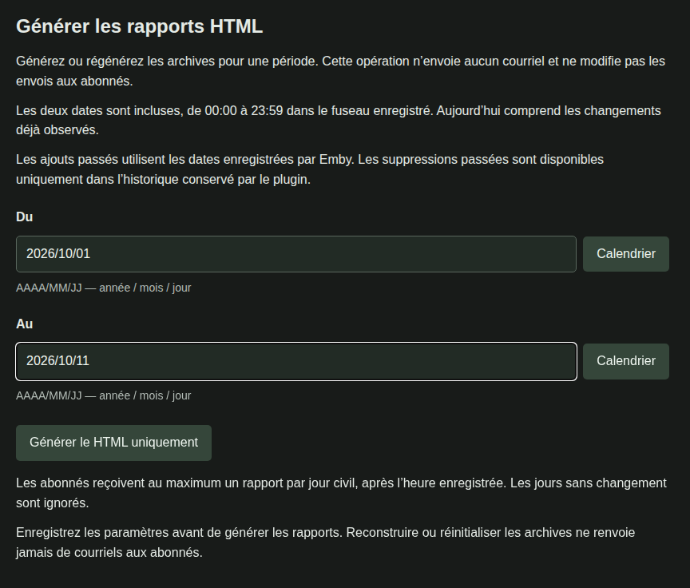
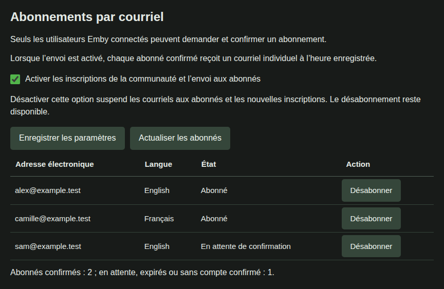
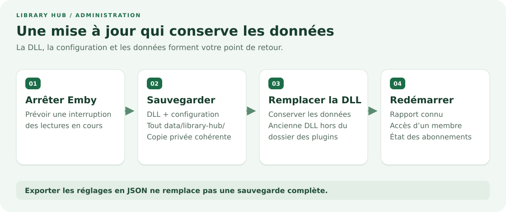

# Guide d’administration

Installez Library Hub, choisissez ce que vous partagez et gérez les rapports et les abonnements.

[Guide utilisateur](user-guide.md){ .md-button }
[Instructions d’installation](INSTALL.md){ .md-button }

## La place de Library Hub dans votre serveur

Library Hub fonctionne dans Emby Server. Les membres utilisent leurs comptes Emby existants.

L’exploration, les rapports enregistrés et les courriels ont des règles d’accès différentes :

{ .guide-diagram }

| Espace                    | Contenu accessible au membre                                  |
| ------------------------- | ------------------------------------------------------------- |
| Explorer / Rechercher     | Médiathèques proposées, limitées par ses droits Emby.         |
| Archives                  | Mêmes rapports enregistrés que tous les autres membres.       |
| Courriels                 | Changements visibles par le compte Emby actuel de l’abonné.   |
| Administration            | Réglages et liste des abonnés, réservés aux administrateurs.  |

!!! warning "Choisir ce qui peut figurer dans les archives communes"

    Tout membre connecté peut lire toutes les médiathèques présentes dans les rapports enregistrés.

    La sélection **Exploration du catalogue** concerne uniquement Explorer et Rechercher.

    Elle ne restreint ni les archives ni les courriels.

## 1. Installer et ouvrir les réglages

Suivez le [guide d’installation](INSTALL.md) pour vérifier le téléchargement et installer l’unique DLL.

La base API est **Emby Server 4.11.0.5**. Le plugin cible **.NET Standard 2.0**.

Le développement utilise Synology avec .NET 8. Les autres versions et plateformes restent à valider.

Redémarrez Emby, connectez-vous comme administrateur, puis ouvrez **Tableau de bord → Avancé → Library Hub**.

## 2. Proposer des médiathèques et choisir le calendrier

1. Cochez les médiathèques dans **Exploration du catalogue**.
2. Choisissez la langue des rapports et le **Fuseau horaire**, par exemple `Europe/Paris`.
3. Indiquez l’adresse publique de base du serveur, par exemple `https://media.example.com`.
4. Gardez les envois quotidiens désactivés pendant la mise en place de l’exploration et des archives.
5. Cliquez sur **Enregistrer**. Les réglages s’appliquent immédiatement.

{ .guide-shot }

*Réglages de démonstration : véritables modèle de page et contrôleur du plugin, avec des données fictives.*

Utilisez l’adresse accessible depuis l’extérieur, avec le préfixe du proxy si nécessaire.

N’ajoutez ni `/web/index.html`, ni lien de vidéo, ni jeton. Copiez les liens destinés aux membres depuis les réglages.

Après enregistrement d’une sélection explicite, cochez les nouvelles médiathèques que vous voulez proposer.

La langue des réglages suit Emby. Celle des archives et celle des courriels de chaque abonné sont indépendantes.

## 3. Publier et vérifier les archives

Gardez la tâche planifiée **Library Hub** active. Son intervalle par défaut est de cinq minutes.

Le premier inventaire établit une référence. Des archives vides juste après l’installation sont normales.

Ouvrez les liens d’exploration, de recherche et d’archives depuis les réglages.

Vérifiez l’exploration avec un compte membre ordinaire, en plus du compte administrateur.

Pour retrouver des ajouts anciens, choisissez une courte période et utilisez **Générer le HTML uniquement**.

{ .guide-shot }

*Véritables commandes de rapport dans l’aperçu de démonstration. Les dates et contenus sont fictifs.*

Les dates suivent **AAAA/MM/JJ**, bornes incluses dans le fuseau enregistré. Les dates futures sont refusées.

Les ajouts anciens peuvent utiliser les dates enregistrées par Emby. Les suppressions antérieures au suivi sont perdues.

L’aperçu du jour actualise les changements suivis sans envoyer de courriel.

La génération HTML reconstruit les pages sans envoyer de courriel ni modifier la progression des abonnés.

## 4. Activer les courriels, si souhaité

L’exploration et les archives fonctionnent sans SMTP. Les abonnements nécessitent un compte SMTP opérationnel.

1. Renseignez le serveur SMTP, l’expéditeur, l’identifiant et le mot de passe fournis par votre prestataire.
2. Utilisez **465** pour TLS implicite, ou **587** avec STARTTLS activé.
3. Choisissez l’heure d’envoi, activez les abonnements communautaires et enregistrez.
4. Abonnez-vous depuis **Mon abonnement** et confirmez le courriel avec le même compte Emby.
5. Activez les courriels quotidiens et enregistrez lorsque vous êtes prêt.

Les deux options doivent être actives pour les rapports quotidiens.

Les confirmations peuvent être envoyées même lorsque les courriels quotidiens sont désactivés.

SMTP authentifié exige TLS. Le prestataire doit accepter l’adresse d’expédition configurée.

{ .guide-shot }

*Adresses fictives dans le véritable tableau des abonnés et ses états traduits.*

Actualisez la liste pour vérifier les états. L’action de désabonnement retire l’abonnement de l’adresse choisie.

L’administrateur s’abonne lui aussi depuis la page membre ; aucun destinataire administrateur distinct n’existe.

## Ce qui se passe chaque jour

{ .guide-diagram }

Le fuseau configuré définit chaque journée. À l’heure prévue, seuls les jours terminés peuvent être envoyés.

Chaque adresse confirmée reçoit au plus un rapport quotidien enregistré comme envoyé par jour civil local.

Les jours vides ou entièrement masqués sont ignorés. Le retard est rattrapé du plus ancien au plus récent.

Le rattrapage reste limité à un rapport par jour d’envoi. Le compte et ses droits sont revérifiés à chaque tentative.

Un échec SMTP est réessayé après une heure, sans bloquer les autres destinataires.

Un accusé SMTP incertain peut toutefois provoquer un doublon ; l’envoi unique absolu n’est pas garanti.

## Maintenir, mettre à jour et restaurer

{ .guide-diagram }

Sauvegardez ensemble la configuration et tout `data/library-hub/` pendant qu’Emby est arrêté.

Conservez aussi l’ancienne DLL hors du dossier actif des plugins avant son remplacement.

Après redémarrage, vérifiez un rapport connu, l’exploration d’un membre et l’état des abonnés.

**Exporter JSON** inclut les réglages et le mot de passe SMTP, mais pas l’historique, les abonnés ou les rapports.

La restauration JSON remplace immédiatement les réglages. Une mise à jour ordinaire de la DLL ne la nécessite pas.

La remise à zéro des archives crée une sauvegarde privée puis efface les rapports publiés.

Elle conserve les abonnés et l’historique. Les anciens liens quotidiens renvoient 404 jusqu’à leur régénération.

La publication automatique reprend avec le jour de remise à zéro et les jours suivants.

Consultez [sauvegarde et restauration](backup.md) pour les chemins exacts et une restauration cohérente.

## Orienter les membres

Partagez le lien d’archives ou d’exploration des réglages, accompagné du [guide utilisateur](user-guide.md).

Chaque lecteur doit avoir un compte actif sur votre serveur. Le lien ne donne aucun accès à lui seul.

Utilisez un navigateur si l’application Android ou TV ne montre pas Library Hub.

Pour un rapport ou courriel absent, consultez le [dépannage](troubleshooting.md) avant de réinitialiser des données.

[Tous les réglages](configuration.md) · [Gestion des archives](archive-administration.md) · [Confidentialité](security.md)
