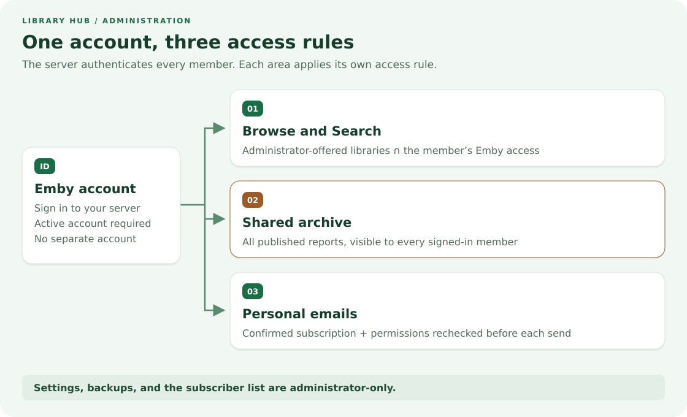
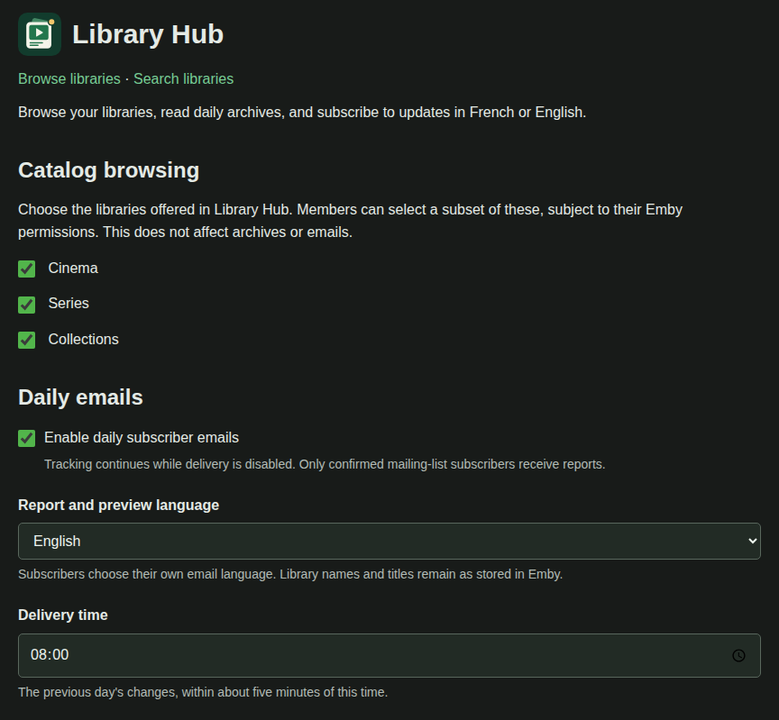
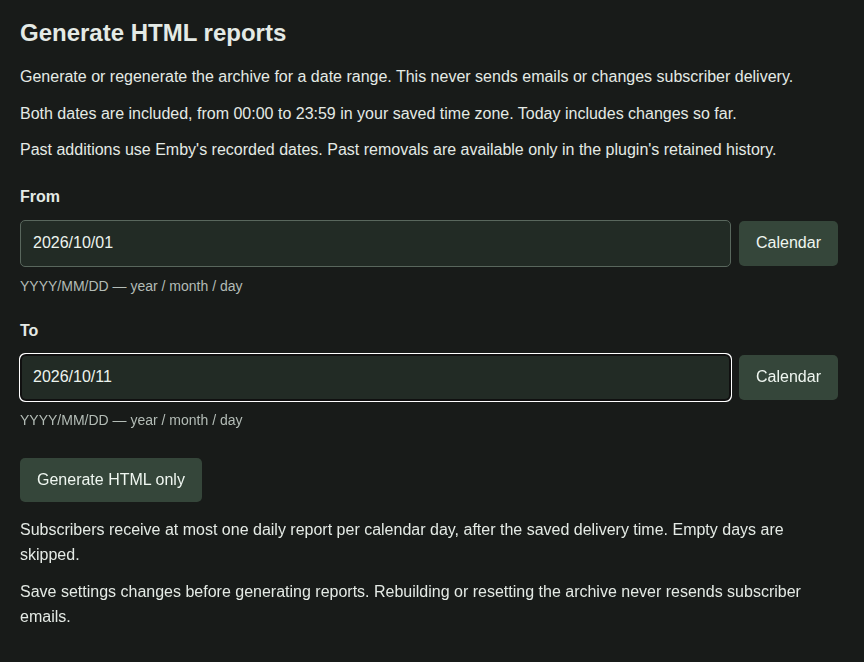
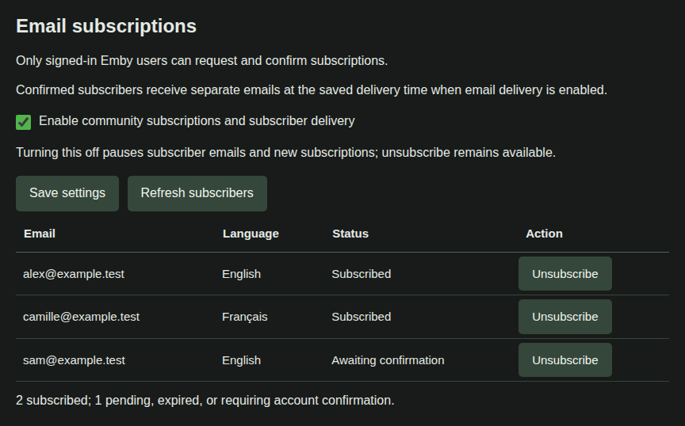
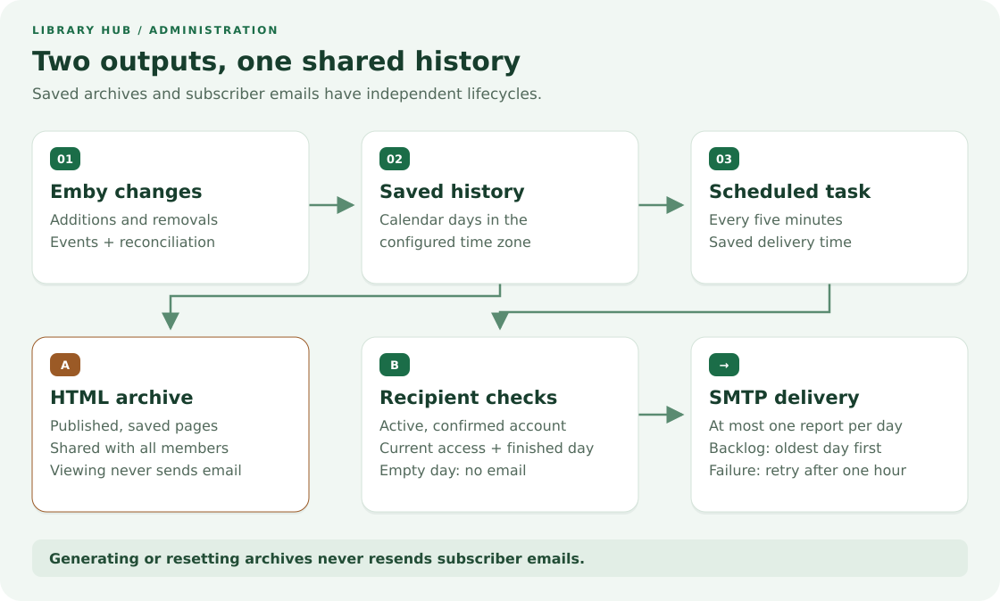
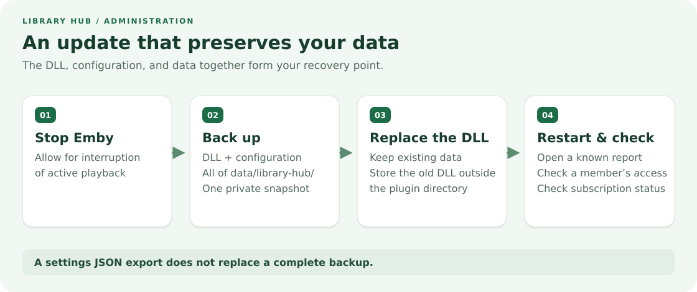

# Administration guide

Set up Library Hub, control what you share, and keep reports and subscriptions running.

[User guide](user-guide.md){ .md-button }
[Installation instructions](INSTALL.md){ .md-button }

## How Library Hub fits into your server

Library Hub runs inside Emby Server. Members use their existing Emby accounts.

Browsing, saved reports, and subscriber emails have different access rules:

{ .guide-diagram }

| Area           | What the member can see                                       |
| -------------- | ------------------------------------------------------------- |
| Browse/Search  | Offered libraries, limited by that member's Emby permissions. |
| Archive        | The same saved reports as every other signed-in member.       |
| Email          | Changes visible to that subscriber's current Emby account.    |
| Administration | Settings and subscriber details, for administrators only.     |

!!! warning "Decide what belongs in the shared archive"

    Every signed-in member can read every reported library in the saved archive.

    The **Catalog browsing** selection limits Browse and Search only. It does not restrict archives or emails.

## 1. Install and open settings

Follow the [installation guide](INSTALL.md) to verify the download and install the single plugin DLL.

The API baseline is Emby Server **4.11.0.5**. The plugin targets **.NET Standard 2.0**.

Development uses Synology with .NET 8. Other server versions and platforms need validation.

Restart Emby after installation, sign in as an administrator, then open **Dashboard → Advanced → Library Hub**.

## 2. Offer libraries and set the reporting calendar

1. Check the libraries to offer under **Catalog browsing**.
2. Set **Report and preview language** and **Time zone**, for example `Europe/Paris`.
3. Set **Public Emby server URL** to the server's base address, such as `https://media.example.com`.
4. Keep email delivery off while setting up browsing and archives.
5. Click **Save**. Settings apply immediately.

{ .guide-shot }

*Demo settings, captured from the plugin template and controller in a local preview with fictional data.*

Choose the externally reachable base URL, including any required proxy prefix.

Do not append `/web/index.html`, an item link, or a token. Copy member links from settings.

After saving an explicit library selection, select any newly created libraries you also want to offer.

The settings language follows Emby. The archive language and each subscriber's email language are separate choices.

## 3. Publish and check the archive

Keep the **Library Hub** scheduled task enabled. Its default interval is five minutes.

The first inventory establishes a baseline. An empty archive immediately after installation is normal.

Open **Browse libraries**, **Search libraries**, and **Open private archive** from settings.

Check Browse using an ordinary member account as well as your administrator account.

To populate earlier additions, choose a small date range and use **Generate HTML only**.

{ .guide-shot }

*The real report controls in the demo preview. Dates and report contents are illustrative.*

Dates use **YYYY/MM/DD** and include both endpoints in the saved time zone. Future dates are rejected.

Historical additions can use Emby's recorded dates. Removals from before tracking began cannot be reconstructed.

**Preview today's report** refreshes tracked changes without emailing anyone.

**Generate HTML only** rebuilds saved pages without sending email or changing subscriber delivery progress.

## 4. Enable subscriber emails, if wanted

Browsing and archives work without SMTP. Email subscriptions need a working SMTP account.

1. Enter the SMTP host, sender address, username, and password from your mail provider.
2. Use port **465** for implicit TLS, or **587** with **Use STARTTLS on ports other than 465** checked.
3. Set the delivery time and enable **community subscriptions**. Save.
4. Subscribe yourself through **My subscription** and confirm the email with the same Emby account.
5. Enable **daily subscriber emails** and save when you are ready to send daily reports.

Both switches must be enabled for daily mail. Confirmation emails can be sent while daily delivery is off.

Authenticated SMTP requires TLS. The provider must accept your configured sender address.

{ .guide-shot }

*Fictional addresses show the actual subscriber table and its translated statuses.*

Use **Refresh subscribers** to inspect the list. **Unsubscribe** removes the selected address's subscription.

Administrators also subscribe through the member page; there is no separate administrator recipient.

## What happens each day

{ .guide-diagram }

The configured time zone defines each calendar day. At delivery time, only completed days are eligible for email.

Each confirmed address receives at most one successfully recorded daily report per local calendar day.

Empty or fully hidden days are skipped. Backlogs catch up oldest first, one report per delivery day.

Before each attempt, the plugin rechecks the account and its current permissions.

SMTP failures retry after an hour without blocking other recipients.

An uncertain SMTP acknowledgement can still cause a duplicate; delivery is not an exactly-once guarantee.

## Maintain, update, and recover

{ .guide-diagram }

Back up the configuration and the entire `data/library-hub/` directory together while Emby is stopped.

Keep a copy of the installed DLL outside the live plugin directory before replacing it.

After restarting, verify a known report, a member's browsing access, and subscriber status.

**Export JSON** includes settings and the SMTP password. It does not include history, subscribers, or saved reports.

**Restore from JSON** replaces saved settings immediately. An ordinary DLL update does not need a JSON restore.

**Reset archive list** saves a private backup and clears published reports, preserving subscribers and tracked history.

Old daily links return 404 until regenerated. Automatic publication resumes with the reset day and future days.

See [backup and recovery](backup.md) for exact file paths and consistent restore instructions.

## Give members the right starting point

Share the archive or Browse link from settings, together with the [user guide](user-guide.md).

Every reader needs an active account on your Emby server. A shared link grants no access by itself.

Use a browser when the Android or TV app does not show Library Hub.

For a missing report or email, use [troubleshooting](troubleshooting.md) before resetting any data.

[All settings](configuration.md) · [Archive operations](archive-administration.md) · [Privacy and security](security.md)
