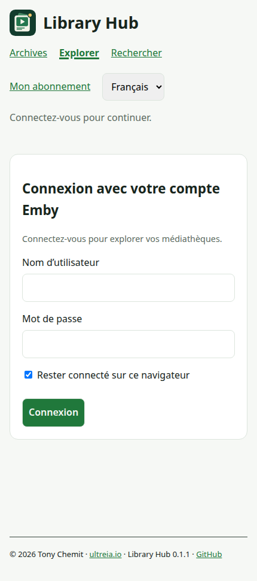
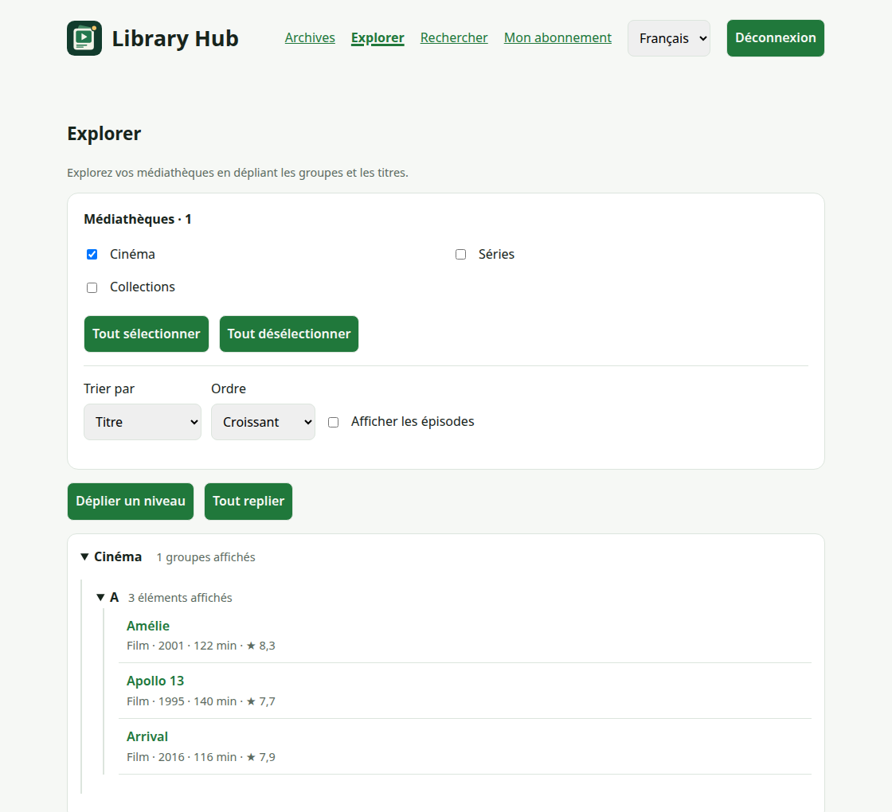
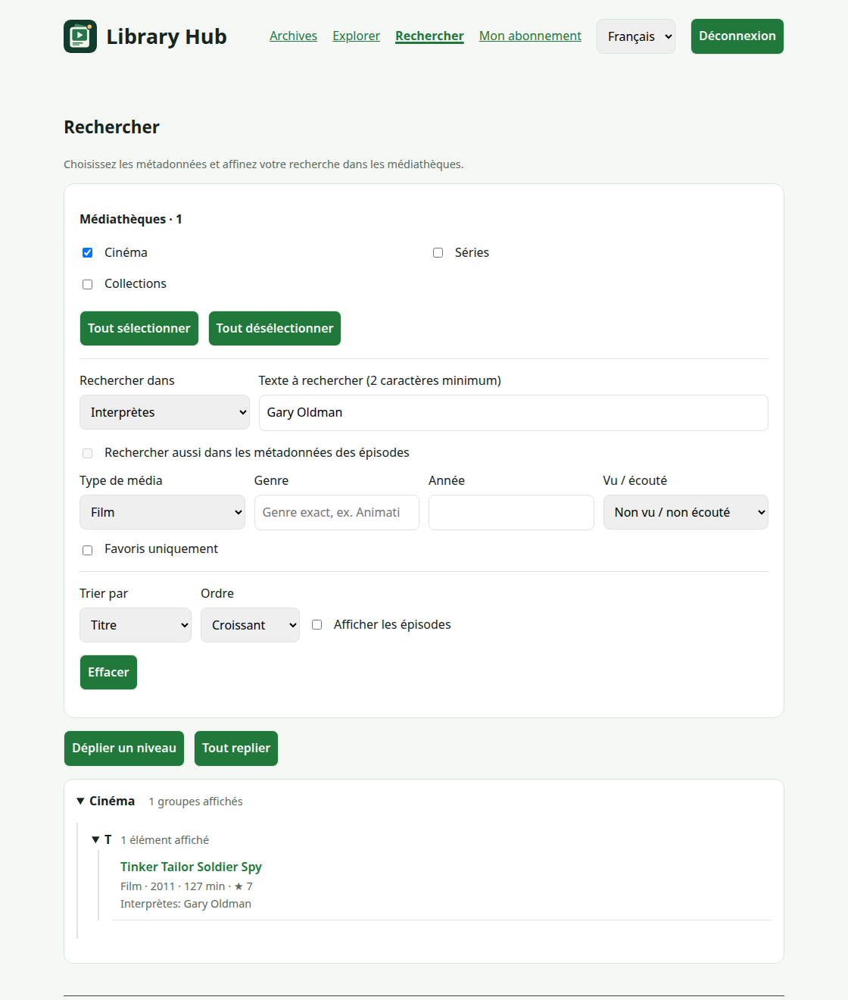
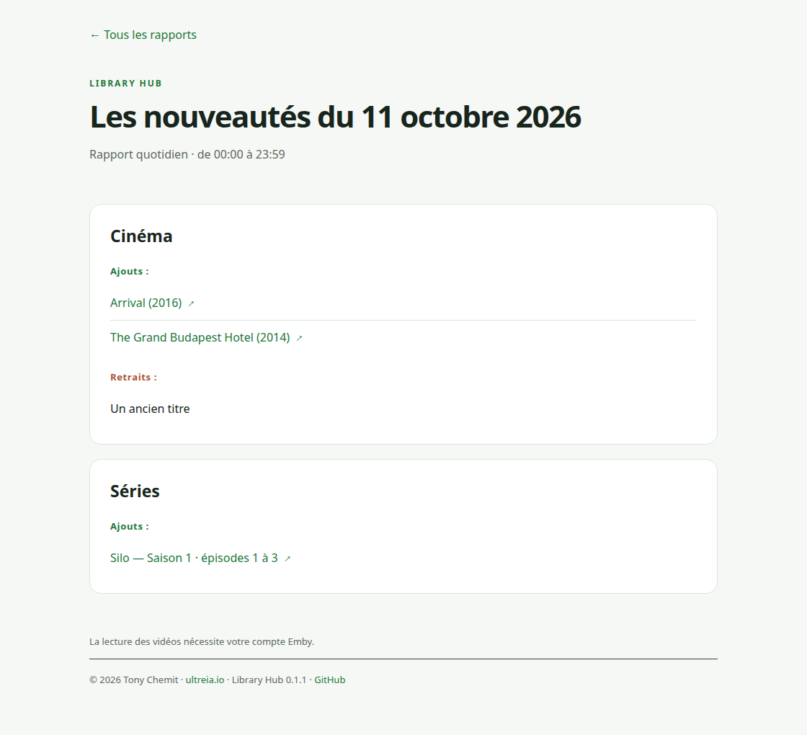
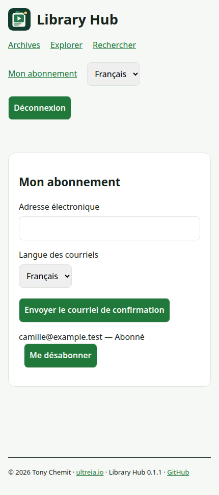

# Guide utilisateur

Trouvez quoi regarder, consultez les nouveautés et choisissez de recevoir ou non des courriels.

Il vous faut un compte actif sur votre serveur Emby et un lien Library Hub fourni par son administrateur.

## 1. Se connecter avec son compte Emby

Ouvrez le lien dans votre navigateur. Utilisez votre identifiant et votre mot de passe habituels pour ce serveur Emby.

Une session Emby Web existante peut être réutilisée dans le même navigateur, sur le même serveur et à la même adresse.

Sinon, Library Hub vous demande de vous connecter. Aucun compte Library Hub distinct n’est nécessaire.

{ .guide-shot .guide-phone }

*Véritable page membre au format téléphone. Toutes les captures de ce guide utilisent des données fictives.*

Gardez **Rester connecté sur ce navigateur** coché sur votre appareil personnel. Décochez-le sur un appareil partagé.

Utilisez **Déconnexion** après usage sur un appareil partagé.

Un autre navigateur ou appareil peut demander une connexion.

Sur Android, ouvrez le lien dans Firefox ou un autre navigateur. Ajoutez-le aux favoris pour le retrouver facilement.

Library Hub peut être absent des menus Android et TV d’Emby. Utilisez alors le navigateur d’un téléphone ou ordinateur.

## 2. Explorer ses médiathèques

Choisissez **Explorer**. Les médiathèques accessibles s’ouvrent automatiquement, sans saisir de recherche.

1. Sélectionnez les médiathèques à parcourir.
2. Choisissez un tri : titre, date, année, note, réalisation ou interprète.
3. Dépliez un groupe, puis un titre ou une série.
4. Ouvrez le titre dans Emby lorsque vous avez trouvé quoi regarder.

{ .guide-shot }

Le navigateur mémorise votre sélection. Seules les médiathèques proposées et autorisées par Emby apparaissent.

Les séries se déplient en saisons. Activez **Afficher les épisodes** pour aller jusqu’aux épisodes.

**Afficher la suite** poursuit une longue branche. **Tout replier** ferme l’arbre sans modifier la sélection.

## 3. Rechercher un titre, une personne ou une idée

Ouvrez **Rechercher**, puis choisissez **Rechercher dans**.

Saisissez au moins deux caractères, ou utilisez un filtre sans texte.

Essayez **Interprètes** avec `Gary Oldman`, puis limitez les résultats aux films non vus.

{ .guide-shot }

Les résultats suivent votre saisie. La recherche ignore la casse et les accents.

La recherche par titre inclut les titres originaux. Les autres champs couvrent résumé, réalisation, genres et studios.

Les étiquettes et l’année sont également disponibles.

**Rechercher aussi dans les métadonnées des épisodes** inclut leurs résultats et active **Afficher les épisodes**.

**Effacer** réinitialise les critères en conservant les médiathèques et le tri.

Pour les collections et les règles de tri, consultez [Explorer les médiathèques](browse.md).

## 4. Lire les nouveautés quotidiennes

Ouvrez **Archives**, choisissez un mois et une journée, puis lisez les ajouts et retraits par médiathèque.

{ .guide-shot }

*Exemple de rapport généré par le moteur HTML de Library Hub.*

Les titres ajoutés peuvent mener à leur page Emby. Les titres retirés n’ont pas de lien de lecture.

La journée actuelle peut être indiquée en cours. Des archives vides signifient qu’aucun rapport n’est encore publié.

Les archives sont communes aux membres connectés et peuvent mentionner des titres hors de vos accès personnels.

L’ouverture d’un titre reste soumise à vos droits Emby. L’exploration et les courriels respectent vos accès.

## 5. Choisir les courriels

1. Ouvrez **Mon abonnement** et indiquez votre adresse électronique.
2. Choisissez **Français** ou **English**, puis **Envoyer le courriel de confirmation**.
3. Ouvrez le dernier lien reçu dans les 24 heures.
4. Connectez-vous avec le même compte Emby, puis cliquez sur **Confirmer mon abonnement**.

{ .guide-shot .guide-phone }

Ouvrir le lien ne confirme rien à lui seul. Le bouton de confirmation termine l’inscription.

Le suivi commence au jour civil de confirmation. Les courriels couvrent les journées terminées ayant des changements.

Les jours vides sont ignorés. L’administrateur choisit l’heure et active ou suspend les envois quotidiens.

Votre langue de courriel est indépendante de celle du site. Le sélecteur du site change sa langue d’affichage.

Pour arrêter les envois, utilisez **Me désabonner** ou suivez le lien d’un courriel et confirmez votre choix.

Pour changer la langue des courriels, demandez une nouvelle confirmation pour la même adresse, puis confirmez-la.

## Si quelque chose manque

| Problème                 | Vérification à effectuer                                                     |
| ------------------------ | ---------------------------------------------------------------------------- |
| Connexion impossible     | Utilisez le compte de ce serveur ; contactez son administrateur.             |
| Médiathèque absente      | Vérifiez votre sélection, les droits Emby et l’offre du serveur.             |
| Aucun résultat           | Effacez les filtres ou changez **Rechercher dans**.                          |
| Confirmation impossible  | Utilisez le dernier lien et le compte à l’origine de la demande.             |
| Aucun courriel quotidien | Vérifiez les indésirables et la confirmation ; les jours vides sont ignorés. |
| Aucun menu Android ou TV | Ouvrez le lien partagé dans le navigateur d’un autre appareil.               |

[Abonnements](subscriptions.md) · [Archives quotidiennes](archive.md) · [Dépannage](troubleshooting.md)
