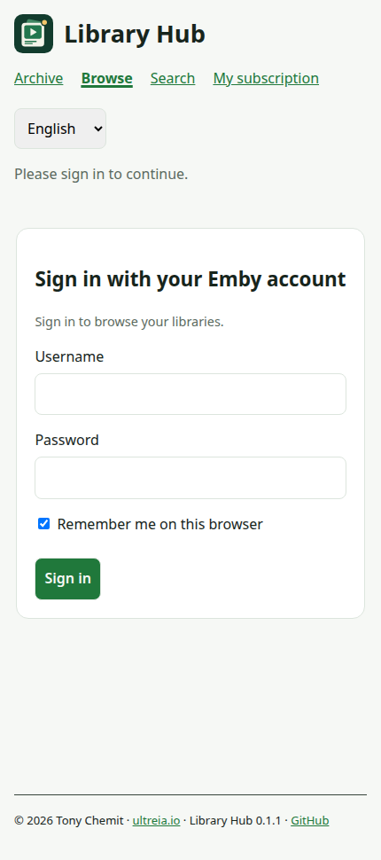
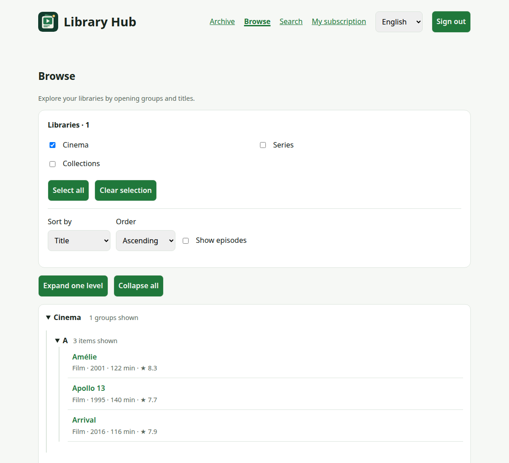
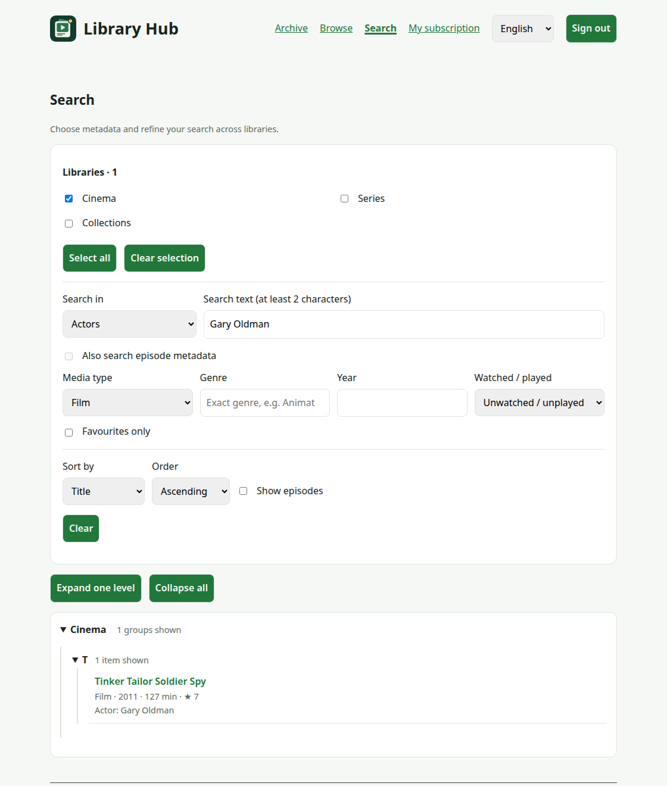
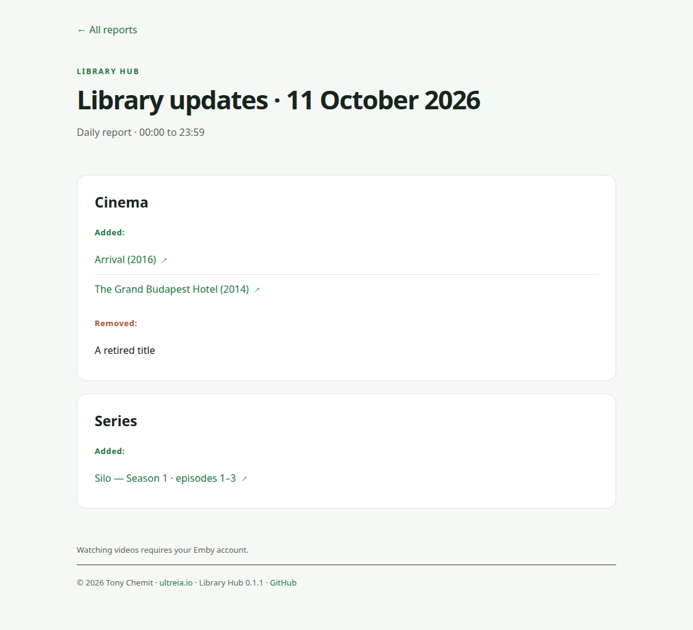
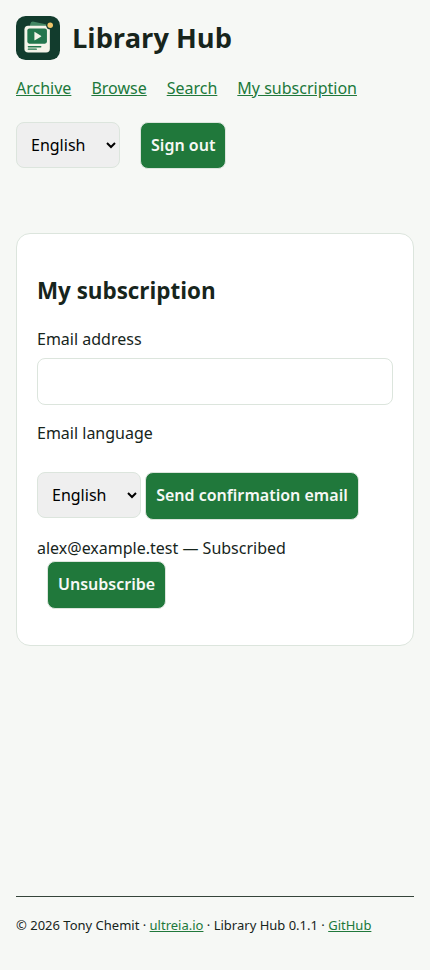

# User guide

Find something to watch, read library updates, and choose whether to receive emails.

You need an active account on your Emby server and a Library Hub link from its administrator.

## 1. Sign in with your Emby account

Open the shared link in your browser. Use your usual username and password for that Emby server.

An existing Emby Web session can be reused on the same browser, server, and site address.

Otherwise, Library Hub asks you to sign in. No separate Library Hub account is needed.

{ .guide-shot .guide-phone }

*The actual member page at phone width. All screenshots in this guide use fictional demo data.*

Keep **Remember me on this browser** checked on your own device. Uncheck it on a shared device.

Use **Sign out** when finished on a shared device. Another browser or device may ask you to sign in again.

On Android, open the link in Firefox or another browser. You can bookmark it for quick access.

Library Hub may be absent from Emby's Android and TV menus. Use your phone or computer browser in that case.

## 2. Browse your libraries

Choose **Browse**. Your accessible libraries open automatically; you do not need to enter a search.

1. Select the libraries you want to explore.
2. Choose a sort order: title, date, year, rating, director, or actor.
3. Expand a group, then a title or series.
4. Open a title in Emby when you find something to watch.

{ .guide-shot }

Your library selection is remembered in this browser. You only see libraries offered to you and allowed by Emby.

Series expand into seasons. Enable **Show episodes** to continue into individual episodes.

**Load more** continues a long branch. **Collapse all** closes the tree without changing your selection.

## 3. Search for a title, person, or idea

Open **Search** and choose **Search in**. Enter at least two characters, or use a filter without text.

Try **Actors** with `Gary Oldman`, then narrow the results to films you have not watched.

{ .guide-shot }

Results update as you type. Searches ignore case and accents.

Title search includes original titles. Other fields include synopsis, directors, genres, tags, studios, and year.

**Also search episode metadata** includes episode matches and enables **Show episodes**.

Use **Clear** to reset search criteria while keeping your libraries and sorting.

For collections and the full sorting rules, see [Browse libraries](browse.md).

## 4. Read daily updates

Open **Archive**, choose a month and day, then read additions and removals grouped by library.

{ .guide-shot }

*A sample daily report generated by Library Hub's own HTML renderer.*

Added titles can link to their Emby page. Removed titles have no playback link.

Today may be marked as in progress. An empty archive means no reports have been published yet.

The archive is shared by all signed-in members and can list titles outside your personal library access.

Opening a title still uses your Emby permissions. Browsing and subscriber emails follow your account's access.

## 5. Choose email updates

1. Open **My subscription** and enter your email address.
2. Choose **Français** or **English**, then press **Send confirmation email**.
3. Open the latest confirmation link within 24 hours.
4. Sign in with the same Emby account and press **Confirm my subscription**.

{ .guide-shot .guide-phone }

Opening the email link alone does not confirm anything. The confirmation button completes your signup.

Daily emails start with the calendar day of confirmation and cover completed days with visible changes.

Empty days are skipped. The administrator controls whether daily delivery is enabled and when it runs.

Your chosen email language is independent of the website language. Switch the website with its language selector.

To stop emails, use **Unsubscribe** beside your address or follow the unsubscribe link in an email and confirm.

To change email language, request confirmation again for the same address and complete the new confirmation.

## If something is missing

| Problem                   | What to try                                                     |
| ------------------------- | --------------------------------------------------------------- |
| Cannot sign in            | Use your account for this server; ask its administrator.        |
| A library is missing      | Check your selection, then ask about Emby access and offerings. |
| Search finds nothing      | Clear filters or choose a different **Search in** field.        |
| Confirmation link fails   | Use the latest link with the account that requested it.         |
| No daily email            | Check spam and confirmation status; empty days send no report.  |
| No menu in Android or TV  | Open the shared Library Hub link in a phone or desktop browser. |

[Subscriptions](subscriptions.md) · [Daily archive](archive.md) · [Troubleshooting](troubleshooting.md)
